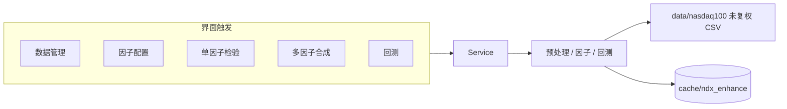

# 纳斯达克100指数增强研究框架 —— 搭建说明（UI驱动版）

这套研究流程挂在现有行情窗口上。右侧下拉从「行情」切到「指数增强」后，窗口只调用 `services`，不读 `data/` 里的 CSV，也不在界面里算因子。行情那五页仍只读 `outdata/` 的 JSON。

示例股票池是 AAPL、MSFT、NVDA，区间 2016-01-01 至 2025-12-31，基准是本地 `NDX.csv`。这是把主流程跑通的小样本，不是 101 只成分股的历史增强结果。

## 1. 项目概述

目标是在纳斯达克 100 上做多头选股，并和 NDX 价格收益比较。默认数据是 `data/nasdaq100/` 里 2015 年起的未复权日线，示例配置取其中近十年。

财务因子、历史成分和预期 EPS 当前没有数据。缺什么就在界面告警，不用现在的名单或前复权价格把缺口补上。



打开窗口、切换「行情」页、点左侧代码，都不会开算。左侧代码只更新焦点，要点「加入左侧选中」才会进股票池。下面这些按钮才会计算：

| 按钮 | 调用 |
| --- | --- |
| 载入并查看覆盖 | `DataService.coverage` |
| 按当前配置计算已选因子 | `FactorService.compute` |
| 运行检验 | `EvalService.single` |
| 合成 | `CompositeService.combine` |
| 运行回测 | `BacktestService.run` |

长任务在后台线程里跑。进度、日志和取消由 `TaskService` 回传。

## 2. 环境依赖

Docker 镜像目标是 Python 3.10。本机 `.venv` 是 Python 3.12.0。代码只用 3.10 就有的语法。

界面是标准库 tkinter，Tcl/Tk 8.6，没有单独的界面框架版本。图用 matplotlib 3.9.2 嵌在窗口里。

| 包 | 版本 | 用途 |
| --- | --- | --- |
| pandas | 2.2.3 | 表格 |
| numpy | 2.1.3 | 数值 |
| matplotlib | 3.9.2 | 行情图和增强图 |
| yfinance | 1.7.0 | 旧的下载脚本，增强流程不调用它 |
| lxml | 5.3.0 | 成分名单的维基解析，增强流程不调用它 |
| scipy | 1.14.1 | 组合权重（SLSQP） |
| pyarrow | 18.1.0 | parquet 缓存；没有它时序列改存 csv |

安装：

```text
pip install -r requirements.txt
```

本机虚拟环境：

```text
.venv\Scripts\python.exe -m pip install -r requirements.txt
```

## 3. 架构设计：UI与后端解耦

```text
界面 gui/enhance.py
    -> Service（services/）
        -> 因子 factors/、预处理 preprocess/、回测 backtest/
        -> 本地 CSV data/nasdaq100/
        -> 缓存 cache/ndx_enhance/
```

`gui/enhance.py` 不导入 `algorithms`、`engine`，也不打开 CSV。行情页 `gui/app.py` 仍然只读 `outdata` JSON。增强计算不进 `engine`，`engine` 继续只管原来的单策略回测。

### Service 接口

公共方法都接受可选的 `refresh`、`cancel`、`progress`。`progress(百分比, 文字)` 用来刷界面。`cancel()` 返回真时抛 `Cancelled`。

| 方法 | 输入 | 输出 | 失败时 |
| --- | --- | --- | --- |
| `ConfigStore.load()` / `save(config)` | 无 / 配置字典 | 配置字典 / 无 | JSON 坏了就退回默认配置 |
| `DataService.coverage(config)` | 配置 | 每只股票的行数、起止、跳空、来源、说明；另附成分告警 | 单只缺失写在该行，不让整页失败 |
| `DataService.prices(symbols, start, end, adjust="raw")` | 代码、区间、复权 | 摘要，不含整段行情 | `qfq` 抛 `AdjustError`；`hfq` 抛 `DataGapError` |
| `DataService.fundamentals(symbols, start, end)` | 代码、区间 | `degraded=true`，行是空的 | 不抛错，告警写明 EDGAR 未接入 |
| `DataService.constituents(as_of)` | 日期 | 代码列表、来源、告警 | 没有当日快照时抛 `ConstituentGapError` |
| `DataService.pull(config)` | 配置 | 与 coverage 相同 | 本地源不会联网 |
| `FactorService.catalog()` | 无 | 因子说明列表 | — |
| `FactorService.compute(config, factor_id)` | 配置、因子 id | 是否降级、告警、最新得分、缓存命中 | 窗口参数不合法抛 `DataGapError` |
| `EvalService.single(config, factor_id)` | 配置、因子 id | IC、ICIR、分组净值、换手 | 因子为空时 IC 为空并降级 |
| `CompositeService.combine(config)` | 配置 | 权重、相关性、最新得分 | 没有可合成因子时抛 `DataGapError` |
| `BacktestService.run(config)` | 配置 | 全样本 / 训练 / 验证指标、分年、净值 | 快照模式缺文件时抛 `ConstituentGapError` |
| `TaskService.start(name, fn)` | 名称，`fn(progress, cancel)` | 任务 id | 异常写进 `poll` 的 error |
| `TaskService.cancel(task_id)` | 任务 id | 无 | 未知 id 忽略 |
| `TaskService.poll(task_id)` | 任务 id | status、progress、logs、result | 未知 id 的 status 为 missing |

`FactorService.panel`、`CompositeService.score_frame`、`DataService.load_market` 只给别的服务用，界面不要调。

异常：

| 异常 | 何时 |
| --- | --- |
| `SourceUnavailable` | 数据源关闭或尚未接入 |
| `DataGapError` | 缺文件、缺字段、日期反了、约束无解 |
| `AdjustError` | 前复权，或无法识别的复权方式 |
| `LookaheadError` | 公告日之后没有交易日，这条财务记录不能用 |
| `ConstituentGapError` | 该日没有历史成分，也不能用现在的名单回填 |
| `Cancelled` | 用户点了取消 |

### 页面与 Service

| 页面 | Service |
| --- | --- |
| 数据管理 | `DataService`、`ConfigStore` |
| 因子配置 | `FactorService`、`ConfigStore` |
| 单因子检验 | `EvalService` |
| 多因子合成 | `CompositeService` |
| 回测 | `BacktestService` |

清除缓存调用 `Store.clear()`，只删 `cache/ndx_enhance/`。

界面不直接读写行情文件。配置文件 `config/ndx_enhance.json` 由 `ConfigStore` 读写，表单不自己拼路径。API Key 只进这个 JSON，不要提交到 Git。

## 4. 按需加载与缓存策略

只有当前股票池、当前勾选的因子、当前区间会计算。默认三只股票加 NDX，不会预计算 101 只。

缓存目录是 `cache/ndx_enhance/`，已在 `.gitignore` 里。

| 内容 | 介质 |
| --- | --- |
| 行情宽表、因子得分、合成得分 | `series/<键>.parquet` |
| 跳空日期、IC、告警、任务摘要 | `results.sqlite` |

没有 pyarrow 时，序列改存同名 csv，结果里会加一句告警。空表直接存 csv，避免 parquet 写不出空表。

键是 SHA1，材料包括：

- 缓存版本 `CACHE_VERSION`（改了公式就升这个版本）
- 股票、区间、复权、数据源顺序
- 因子参数、中性化名单、跳空阈值
- 每个 CSV 的修改时间和大小

同一键再跑会命中。示例里残差动量第一次是 miss，紧接着的低波动读行情时已经是「行情使用缓存」，检验阶段两个因子都是「使用缓存」。

失效规则：

- CSV 被改写后，修改时间变了，键变了，旧文件不再被读到。
- 只改成本、权重上限，不会让行情键失效；因子键会带上自己的参数。
- 改了计算代码但没升 `CACHE_VERSION`、也没改文件时间时，可能读到旧得分。这时点「清除缓存」。
- `refresh=True` 会先删掉这一次的键再算。界面上的「清除缓存」是整目录删掉。

长任务：`TaskService` 起一个 daemon 线程，界面每 150 毫秒 `poll`。日志最多留 400 行。点「取消」后，服务在下一只股票或下一次再平衡检查 `cancel()`，然后抛 `Cancelled`。已经写了一半的缓存文件可能还在，下次按键读取；不想留就清缓存。

## 5. 配置可视化

配置在 `config/ndx_enhance.json`。表单打开时 `load`，每次运行前 `validate_config` 再 `save`。校验失败会弹出原因，不会开算。

| 字段 | 位置 | 示例 |
| --- | --- | --- |
| `source_order[0]` | 数据管理 / 主数据源 | `local_csv` |
| `api_keys.nasdaq_data_link` | 数据管理 / API Key，星号显示 | 空 |
| `universe_mode` | 数据管理 / 股票池来源 | `manual` 或 `snapshot` |
| `universe` | 数据管理 / 股票池 | AAPL, MSFT, NVDA |
| `start` / `end` | 数据管理 | 2016-01-01 / 2025-12-31 |
| `factors.<id>.enabled` | 因子配置 / 勾选 | 动量和低波动为 true |
| `factors.residual_momentum.lookback` / `skip` | 因子配置 | 252 / 21 |
| `factors.low_volatility.lookback` | 因子配置 | 60 |
| `neutralize` | 因子配置 / 中性化勾选 | beta, liquidity |
| `horizon` | 单因子检验 / 预测期 | 21 |
| `weight_scheme` | 多因子合成 | `equal` / `ic` / `max_icir` |
| `rebalance` | 回测 | `M` 或 `Q` |
| `cost_bps` / `slippage_bps` | 回测 | 10 / 5 |
| `max_weight` | 回测 | 0.5 |
| `diversify_penalty` | 回测 | 1.0 |
| `adjust` | 高级选项 | `raw` |
| `jump_limit` | 高级选项 | 0.5 |
| `train_years` / `valid_years` | 高级选项 | 7 / 3 |
| `beta_lookback` / `liquidity_lookback` | 高级选项 | 252 / 20 |
| `benchmark` | 高级选项 | NDX |

高级选项默认折叠。复权、跳空阈值、训练年数、贝塔和流动性窗口、基准在里面。成本、再平衡和单名上限留在回测页，因为那一页要直接改它们。

选「前复权」再运行，会得到 `AdjustError`，不会偷偷改去算。选「后复权」会得到 `DataGapError`，因为本地没有分红和拆股因子。

## 6. 数据源配置与降级策略

价格按 `source_order` 依次试，成功就停。

| 顺序 | 代号 | 行为 |
| --- | --- | --- |
| 1 | `local_csv` | 读 `data/nasdaq100/<代码>.csv` 的 `Close` 和 `Volume`，不读 `Adj Close` |
| 2 | `yahoo` | 直接拒绝。yfinance 默认复权，不能当未复权源 |
| 3 | `nasdaq_data_link` | 没 Key 就提示去填；Key 只留在本地，接口没接，不会发请求 |

EDGAR、Fama-French、QQQ 历史持仓也在适配器里，同样拒绝联网。财务走 `fundamentals()`，固定降级。

覆盖表的列是代码、行数、起始、结束、跳空天数、来源、说明。主源失败又用了后面的源时，说明里写「已降级」和原因。单日涨跌绝对值超过 `jump_limit`（默认 0.5）记为疑似拆股，日期列在说明里，最多先显示 5 天。

成分股：

- 快照文件放在 `data/nasdaq100/snapshots/YYYY-MM-DD.txt`，一行一个代码。
- 该日有快照就用快照。
- 日期在 2026-10-01 及以后、且没有快照时，才读 `data_fetch/nasdaq100_constituents.txt`，并告警这是 2026-10 的静态名单。
- 更早的日期没有快照就抛 `ConstituentGapError`，文案写明也没有 QQQ 历史持仓。

数据管理页底部会显示快照个数、手填名单的幸存者偏差，以及起始日缺快照的原文。示例配置是手填，所以这三句都会出现。

增强流程不读 `data/tech-us-10y` 或 `data/manufacturing-us-10y`。那些文件来自 yfinance 的复权下载，和这里的未复权 CSV 不是同一套价格。

## 7. 目录结构说明

| 目录 | 职责 |
| --- | --- |
| `services/` | 配置、数据、因子、检验、合成、回测入口、任务。界面只进这一层 |
| `factors/` | 因子目录 `catalog.py`，以及能用行情算的函数 `price.py` |
| `preprocess/` | 公告日对齐、去极值、标准化、中性化、收益清洗 |
| `backtest/` | 权重优化和持仓模拟 |
| `config/` | `ndx_enhance.json` |
| `cache/` | 按需缓存，不提交 |
| `tests/` | 未来函数、幸存者、复权和契约测试 |
| `data/nasdaq100/` | 已有的未复权日线，含 `NDX.csv` |
| `gui/enhance.py` | 五个研究页 |

## 8. 因子定义与计算公式

方向 1 表示越高越好，方向 -1 表示越低越好。合成前会把得分乘上方向。风险因子方向为 0，只给中性化用。

价格一律用未复权 `Close`。收益里，绝对值超过跳空阈值的那一天记 0，收盘价文件不改。

### 能计算的

**残差动量** `residual_momentum`，量价，方向 1，默认勾选。

- 窗口：`lookback` 默认 252，跳过最近 `skip` 默认 21 个交易日。可在因子页改。
- 在 t 日，窗口 W 为 `[t-skip-L+1, t-skip]`。
- β = Cov(r, r_NDX) / Var(r_NDX)，在 W 上估计。
- 因子 = Σ(r − β r_NDX)，等于 L 乘以同一窗口的詹森阿尔法。
- 不用最近 skip 天，避免把当月反转算进动量。

**低波动** `low_volatility`，量价，方向 -1，默认勾选。

- 过去 `lookback` 日（默认 60）日收益的样本标准差，再乘 sqrt(252)。
- 用到当日收益。

**贝塔** `beta`，风险，只中性化。

- 过去 `beta_lookback` 日（默认 252）的 Cov / Var，用到当日。
- 可在单因子页查看，不进合成。

**流动性** `liquidity`，风险，只中性化。

- 过去 `liquidity_lookback` 日（默认 20）成交量均值的对数。
- 没有流通股本，所以不是换手率。

### 当前为空的

这些因子在目录和勾选框里都在。勾上之后结果为空，`degraded=true`，并带上下面的原因。

| id | 名称 | 公式 | 字段 | 窗口 | 方向 |
| --- | --- | --- | --- | --- | --- |
| `gross_margin_sharpe` | 毛利率稳定性 | 毛利率均值 / 标准差，毛利率 = 毛利 / 营收 | gross_profit, revenue, announce_date | 12 季 | 越高越好 |
| `rd_to_sales` | 研发强度 | 研发费用 / 营收的均值 | rd_expense, revenue, announce_date | 12 季 | 越高越好 |
| `revenue_growth` | 每股营收增长 | 每股营收同比增速的 3 年均值。每股营收 = 营收 / 稀释股本 | revenue, diluted_shares, announce_date | 12 季 | 越高越好 |
| `fwd_eps_growth` | 预期EPS增长 | (EPS_fy2 / EPS_fy0) ^ (1/2) − 1 | 两个财年的一致预期 | 未来两个财年 | 越高越好。没有预期时为空 |
| `cfo_to_sales` | 经营现金流占营收 | 近四季经营现金流 / 营收 | cfo, revenue, announce_date | 4 季 | 越高越好 |
| `roe_stability` | ROE稳定性 | ROE 均值 / 标准差 | roe, announce_date | 12 季 | 越高越好 |
| `peg` | PEG | 市盈率 / 预期盈利增速 | pe, expected_growth | 当期 | 越低越好。排序参考，默认不勾 |
| `size` | 市值 | log(收盘价 × 股本) | close, shares_outstanding | 当日 | 只中性化 |
| `industry` | 行业 | 行业哑变量 | industry | 当日 | 只中性化 |

财务类数值要先过 `signal_date`：信号日是公告日之后的下一个交易日，公告当天不能用。

## 9. 预处理流程

只对选股因子做。顺序是去极值、标准化、中性化，最后乘方向。

1. 去极值：每个交易日的截面，中位数 ± 3 × 1.4826 × MAD。MAD 为 0 时该日不动。
2. 标准化：截面 z-score，分母用总体标准差（ddof=0）。标准差为 0 时该日记 0。
3. 中性化：用当日得分对风险因子做带截距的最小二乘，取得残差。默认风险因子是贝塔和流动性。

样本数 ≤ 风险因子个数 + 1 时，整段跳过中性化，告警写明股票只数。三只股票对两个风险因子就是这种，示例里会看到「本次跳过」。某一天的风险因子不齐，则那一天保留标准化后的值。

市值和行业在中性化名单里勾上时，因为没有数据，会被跳过并告警，不会填一个假的暴露。

风险因子自己被拿去检验时，只做去极值和标准化，不再对自身回归。

## 10. 单因子检验与多因子合成

检验只用月末截面，避免重叠的未来收益把 ICIR 抬高。

- 未来收益 = close[t+horizon] / close[t] − 1。horizon 默认 21 个交易日，在检验页修改。
- IC 是该日得分和未来收益的 Spearman 相关。
- ICIR = IC 均值 / IC 样本标准差。旁边的 t 是均值除以标准误，只作描述，三只股票时不要当成显著性。
- 分层：股票不少于 5 只时分 5 组；不足 5 只时改成高低两组，并告警。持有到下一次再平衡，组内等权。
- 换手是相邻两期分组标签发生变化的比例。

IC 和分层用到了未来价格，只出现在检验页。合成权重不会用还没走完的 IC。

权重方案在合成页切换：

| 方案 | 代号 | 做法 |
| --- | --- | --- |
| 等权 | `equal` | 已启用且没有降级的因子各 1/N |
| IC 加权 | `ic` | 过去最多 36 个已完成月末 IC 的均值，负数截成 0，再归一 |
| 最大 ICIR | `max_icir` | 同样的历史里，均值 / 标准差，负数截成 0，再归一 |

「已完成」的截止日是 `known_cutoff`：站在再平衡日，向前数 horizon 个交易日。更晚的 IC 还包含没实现的收益，不能用。历史不足 12 期，或截断后权重和为 0，退回等权并告警。

权重只向后填充，不会把以后才知道的权重填回前面。相关性是各因子得分堆在一起之后的 Spearman。

PEG 如果被勾上且以后有数据，会带一句「排序参考」再进入合成。现在没有数据，勾了也只是降级。

## 11. 组合优化与回测

再平衡默认每月，可改每季。权重在当日收盘确定，从下一交易日的收益开始算。再平衡当天的涨跌不进组合。

成本 = Σ|Δw| × (成本 bps + 滑点 bps) / 10000，在换仓后的下一日记。换手按单边计，即 Σ|Δw| 的一半。默认成本 10 bps，滑点 5 bps。

约束：

- 权重和为 1，不做空，没有现金仓。
- 单名上限 `max_weight`。上限乘以股票数小于 1 时直接报约束无解。
- `diversify_penalty` 把权重拉向等权。这是软的分散项，不是相对 NDX 的跟踪误差上限。
- 求解器用 scipy 的 SLSQP。没有安装 cvxpy。

跟踪误差在结果里报告：组合日超额收益的样本标准差 × sqrt(252)。它没有写进优化约束。三只股票也复制不出 NDX，组合是这些股票的多头，不是带成分股权重的指数增强。

指标：累计收益、年化、波动、夏普（无风险利率 0，与 `engine` 一样用 ddof=1）、最大回撤、相对基准的累计超额、年化跟踪误差、平均单边换手、累计成本。训练、验证、全样本各一份。分年给出策略、基准和超额。

训练段从配置起始日往后数 `train_years` 个自然年，默认到 2022-12-31，验证从 2023-01-01 开始。因子预热期没有持仓，不放进净值。动量要大约 273 个交易日才有第一笔得分，所以 2016 年大多在预热里，分年从 2017 开始。

界面回测页上面是指标和分年，下面两张图是净值和回撤。

## 12. UI各页面操作步骤

先在项目根目录运行 `python -m gui`。右侧第一个下拉里选「指数增强」。左边的数据集和算法列表仍是行情页用的，增强计算不读它们。

### 数据管理

1. 主数据源保持「本地未复权 CSV」。
2. 需要 Nasdaq Data Link 时再填 Key。现在填了也不会发请求。
3. 股票池来源保持「手填名单」。改成「历史快照」之前，要先把每个再平衡日的 txt 放进 `snapshots/`，否则回测会停在缺快照上。
4. 在左侧点一只代码，按「加入左侧选中」。股票池里不要依赖科技股那套复权文件里的价格。
5. 填开始、结束，按「载入并查看覆盖」。
6. 看跳空列和页顶告警。示例里 AAPL 在 2020-08-31、NVDA 在 2021-07-20 和 2024-06-10 各有一次跳空，NDX 和 MSFT 没有。
7. 要改 CSV 或改完公式后，按「清除缓存」。

### 因子配置

1. 勾选因子。默认是残差动量和低波动。财务因子名称后面带「无数据」。
2. 设动量回看、动量跳过、波动回看。
3. 「公式说明」下拉里选因子，下面是公式、字段、窗口和方向。
4. 中性化默认勾贝塔和流动性。三只股票时运行后会提示跳过。
5. 按「按当前配置计算已选因子」，看最新得分。

### 单因子检验

1. 选因子，设预测期。
2. 按「运行检验」。
3. 上面是 IC 均值、ICIR、t、分组数和换手。图上是月末 IC，以及高低分组净值。

### 多因子合成

1. 选等权、IC 加权或最大 ICIR。
2. 按「合成」。
3. 看最新权重、因子相关性和最新得分。权重和应为 1。
4. 确认得分之后再去回测页。回测会按当时配置再取一次合成结果，缓存命中时不会重算因子。

### 回测

1. 选每月或每季，填成本、滑点、单名上限、分散惩罚。
2. 按「运行回测」。
3. 看全样本、训练、验证的收益、夏普、回撤、跟踪误差，以及分年，还有净值与回撤图。
4. 页首告警里会重复幸存者偏差，并说明跟踪误差不是硬约束。

底部进度条和日志对所有页面共用。已有任务在跑时再按按钮，会提示先取消。

## 13. 运行与示例

示例配置就是仓库里的 `config/ndx_enhance.json`。

| 字段 | 含义 |
| --- | --- |
| universe | AAPL、MSFT、NVDA，手填 |
| benchmark | NDX，读 `NDX.csv`，不是 QQQ |
| start / end | 2016-01-01 至 2025-12-31 |
| adjust | raw |
| universe_mode | manual |
| rebalance | 每月 |
| cost_bps / slippage_bps | 10 / 5 |
| max_weight | 0.5，三只股票下上限之和大于 1 |
| diversify_penalty | 1.0 |
| jump_limit | 0.5 |
| horizon | 21 |
| weight_scheme | equal |
| train_years / valid_years | 7 / 3 |
| 因子 | 只打开残差动量（252，跳过 21）和低波动（60） |

命令：

```text
python -m unittest tests.test_contracts -v
python -m gui
```

窗口里的主流程与上面第 12 节相同。

2026-10-19 用上述配置跑通后的摘要如下。IC 接近 0，收益很高，是因为这三只股票本身在这十年涨得多，不能当成因子有效或指数增强成立的证据。

覆盖：

- AAPL、MSFT、NVDA 各 2514 行，2016-01-04 至 2025-12-31。NDX 2513 行。
- AAPL 跳空 1 天（2020-08-31），NVDA 跳空 2 天（2021-07-20、2024-06-10）。
- 历史成分快照 0 个。手填名单和 2016-01-01 缺快照的告警都会出现。

因子最新得分（2025 年末附近，中性化已跳过）：

- 残差动量：AAPL 0.380，MSFT -1.370，NVDA 0.990。
- 低波动：AAPL 0.908，MSFT 0.485，NVDA -1.393。低波动已经乘了方向，越高越偏向低波。

检验：

- 残差动量：IC 均值 -0.04，ICIR -0.05，t -0.53，106 个月，高低两组，换手 8.25%。
- 低波动：IC 均值 -0.11，ICIR -0.15，t -1.61，117 个月，换手 13.79%。

回测（训练截至 2022-12-31，验证从 2023-01-01 起）：

| 区间 | 累计 | 年化 | 夏普 | 最大回撤 | 超额 | 跟踪误差 |
| --- | --- | --- | --- | --- | --- | --- |
| 全样本 | 1213.65% | 33.90% | 1.12 | -43.39% | 177.32% | 12.06% |
| 训练 | 328.03% | 28.29% | 0.94 | -41.69% | 108.55% | 11.59% |
| 验证 | 206.91% | 45.61% | 1.54 | -28.97% | 32.97% | 12.93% |

分年策略收益从 2017 年的 48.32% 到 2022 年的 -38.43%，2025 年 6.30%，同年 NDX 为 20.17%。

第一次计算会写缓存。紧接着的检验和回测日志里应出现「使用缓存」。

## 14. 已知局限与注意事项

- 幸存者偏差：手填池是现在还在、而且本地有文件的名字。退市和调出指数的公司不在里面。没有 `snapshots/` 或 QQQ 历史持仓时，界面会明说，回测仍可以在手填模式下跑，但那个结果不是历史成分上的指数增强。
- 公告日滞后：财务信号日必须晚于公告日至少一个交易日。现在没有财务行，所以这条规则由 `signal_date` 的测试守着，还没有真实财报走过。
- 禁止前复权：只读 `Close`。`Adj Close` 在新浪这份文件里通常等于 `Close`，计算仍然不用它。后复权因缺少分红和拆股因子而拒绝。
- 疑似拆股：单日涨跌超过 50% 的收益记 0，价格文件不动。AAPL、NVDA 的拆股会被这样处理。若真有单日跌超 50%，也会被记成 0。这不是复权。
- 分红没有加进股票收益，也没有加进 NDX。两边都是价格收益，相对比较少了一部分股息差。
- 样本外切分：起始日加 7 个自然年是训练段，默认验证从 2023-01-01 到 2025-12-31。动量预热会吃掉训练段开头，2016 年几乎没有持仓。
- 利率环境：没有按加息、降息把因子拆开。同一套动量和低波在不同利率下会变，这里看不出来。
- 预期 EPS：没有一致预期覆盖，`fwd_eps_growth` 和 PEG 保持降级，不会填行业中位数冒充。
- 缓存一致性：键认文件时间和参数，不认函数体。改了公式要升 `services/store.py` 里的 `CACHE_VERSION`，或点「清除缓存」。取消任务可能留下半截文件，下次命中前如果键没变，会读到取消前已经写完的那份。
- 跟踪误差只是结果。三只股票、单名上限 0.5 的组合波动会明显大于一个真正控制了相对 NDX 暴露的增强组合。
- 行业和市值中性化还做不了。示例规模下，贝塔和流动性中性化也会因样本太少被跳过。
